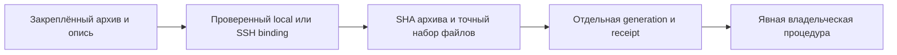

# Доставка закреплённого пакета на узел, версия 1

`python3.13 -m tools.node_artifact --binding PRIVATE_BINDING --request PRIVATE_REQUEST --archive PRIVATE_ARCHIVE` передаёт заранее выбранный ZIP на назначенный local/SSH узел и материализует его отдельную generation. Контракт продолжает [00-INFRA-0018](../adr/00-INFRA-20261113-0018-independent-roles-and-translation-mtls.md) и использует SSH policy [узлового исполнителя](node-execution.md). Он не устанавливает ОС/Python/Docker, не выпускает PKI approvals, не вызывает owner procedure, не меняет Process Control и не выполняет `RESUME`.



## Два вида пакетов

`kind=source` принимает source manifest формата 2 из [build_bundle.py](../../tools/build_bundle.py): repository, source commit, SHA архива и точную опись regular files с SHA/text. Выбор и аутентификация release/manifest принадлежат вызывающему workflow; материализация не подтверждает publisher signature, compatibility, quality или image admission. Receiver не загружает `archive_url` самостоятельно. Архив передаётся через выбранный защищённый канал, без общего межузлового диска и предположения о соседнем checkout.

`kind=owner-input` содержит только явно выбранные закрытые входы одного `scope`. Его manifest имеет ровно `schema_version=1`, `scope`, `archive_sha256`, `files`; каждая запись files содержит только SHA-256. Функция `pack_inputs(input_root, approved_files, scope, output_zip)` читает только переданный список regular files своего оператора с mode `0600` из собственного каталога `0700`. Symlinks, широкие права, лишние/дублирующиеся имена и существующий output запрещены. Архив создаётся сразу с mode `0600` вне source checkout. Пакет не выдаёт credentials и не заменяет решение владельца, какие файлы допустимы конкретной роли. Credentials/API key провайдера не становятся входом worker.

Из source text по его объявленному LF hash восстанавливаются канонические UTF-8/LF bytes; binary files и закрытые входы сохраняют точные байты. Source files имеют mode из закреплённого ZIP, `0644` или `0755`; закрытые files — только `0600`, каталоги — `0700`. При повторе проверяются содержание, точный набор файлов/каталогов и исходные permissions. Содержимое ключей, credential files и archive body не выводится в stdout/метрики.

## Request и автоматический workflow

Request содержит ровно `schema_version=1`, `scope`, абсолютный target `root`, `kind`, `manifest`, `manifest_sha256`, `archive_size`, `receiver_sha256`. Manifest SHA считается от канонического JSON, receiver SHA — от точных байтов инфраструктурного helper. Функция `prepare_request(kind, scope, target_root, manifest, archive)` формирует request после сверки локального архива; target paths синтаксически проверяются контроллером, а filesystem — самим целевым узлом. Binding тот же, что у node execution: local либо SSH с заранее доставленным host key и закрытыми controller diagnostics. Удалённый receiver запускается Python 3.13 из фиксированного carrier; SHA проверяется до исполнения кода, включая режим `-O`.

Пример последовательности внутри общего установщика, без передачи secret values через arguments/environment:

```python
package = pack_inputs(input_root, approved_files, instance_id, private_zip)
request = prepare_request("owner-input", instance_id, node_root, package, private_zip)
receipt = deliver(binding, request, private_zip)
# receipt["path"] становится явным initial-input/env root владельческого шага.
```

`approved_files`, PKI approvals, source release admission и привязку scope к точному placement задаёт owner workflow. Функции не обнаруживают чужие secrets и не выводят состав платформы из файловой системы. Source и private inputs получают разные generations. Обновление receiver не требует переписывать прежнюю generation: после полной сверки её старый receipt сохраняется. Новый manifest/source/input bytes создают отдельный путь, не переключая действующие containers и credentials.

## Проверки и устойчивость

Receiver ограничивает header четырьмя MiB, archive 256 MiB, source — 10 000 files/64 MiB на file, inputs — 128 files/1 MiB на file. Лимит одного input увеличен с 64 KiB для технического owner definition: два настоящих полных source manifests занимают 340 590 bytes уже без остальных полей. Один MiB — ограниченная продуктовая ёмкость для этой metadata, не требование внешнего стандарта и не разрешение передавать domain data. Явный approved list, owner/mode, общий archive limit и reply limit 64 KiB сохраняются. Прогноз перед изменением — 10 минут. Допускаются regular ZIP_STORED entries; absolute/traversal paths, дубли, file/directory collisions, symlinks, encrypted/compressed entries, неуказанные или отсутствующие files и trailing/truncated stream отклоняются. Archive SHA проверяется до распаковки. Все file hashes, modes и directory entries проверяются до атомарной публикации payload. Files, новые каталоги, receipt и final rename синхронизируются с `fsync`.

`root` принадлежит target operator, mode `0700`. `.delivery.lock` исключает параллельных писателей. Отдельные private attempts сохраняют переданный archive и receipt, не удаляя историю. Успешный ответ `ARTIFACT_MATERIALIZED` содержит только scope, hashes, количество files и путь payload; `owner_readiness_verified=false` и `physical_distribution_verified=false` отделяют доставку от готовности нагрузки. Повтор не перезаписывает source/config drift. Неопределённый транспорт не доказывает отсутствие generation: требуется сверка точного manifest/root через тот же проверенный канал. Повтор тех же bytes не выдаёт новые полномочия и не продлевает срок уже выданного bootstrap package.

## Доказательства

[Отчёт](../audit/node-artifact-20261114.json) связывает точный код с unit checks и native SSH цепочкой «полный source archive → отдельный закрытый initial input → public SPIRE CLI из доставленного source». Изменённый wire archive, неверный host key и operator drift отклонены. Initial input в этой проверке синтетический и предназначен только для layout validation; runtime PKI/admission, полный inventory workflow и два реальных физических узла остаются отдельными gates.
