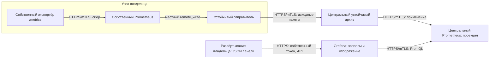

# Руководство: метрики и панели нового владельца

Это инструкция для разработчика сервиса и оператора, которые впервые подключают наблюдение DRP. Она объясняет существующие [00-INFRA-20261106-0009-independent-observability-and-telemetry](../../docs/adr/00-INFRA-20261106-0009-independent-observability-and-telemetry.md), [00-INFRA-20261106-0009-independent-observability-and-telemetry](../../docs/adr/00-INFRA-20261106-0009-independent-observability-and-telemetry.md) и [технический контракт доставки](../../docs/api/telemetry.md), не вводит новый транспорт или каталог потребителей. Запуск самой Grafana, её env, начальный вход, секреты и резервное копирование описаны в [README](README.md).

Навигация: [схема](#1-что-куда-передаётся), [подготовка](#2-что-нужно-получить-до-подключения), [пример владельца](#3-файлы-и-метрика-владельца), [сертификаты](#4-сертификаты-и-секреты), [сбор и доставка](#5-запуск-сборщика-и-доставка-в-центр), [права Grafana](#6-отдельная-учётная-запись-для-публикации), [панель](#7-создание-и-публикация-панели), [проверка и отказы](#8-проверка-данных-и-восстановления), [сопровождение](#9-обновление-отзыв-и-очистка), [воспроизводимый тест](#10-изолированная-сквозная-проверка), [ошибки](#11-диагностика).

## 1. Что куда передаётся



Prometheus собирает численные метрики; он не хранит журналы и определения панелей. Журналы относятся к Loki, трассы — к Tempo, определения панелей — к Grafana. Передача JSON панели не передаёт метрики; поступление метрики не создаёт панель автоматически. Это разные операции с разными удостоверениями. Руководство ниже проверяет именно путь метрик; инструкции логов и трасс находятся у [delivery](../delivery/README.md) и [Collector](../otel-collector/README.md).

Местный Prometheus работает внутри технического контейнера отправителя под его надзором. Это не контейнер приложения: если журнал заполнен или обработчик доставки остановился, отправитель приостанавливает только сбор телеметрии. Приложение продолжает работать. Отдельный бесконтрольный Prometheus с прямым `remote_write` через WAN не соответствует принятой гарантии: возраст его WAL не должен приводить к потере неподтверждённого.

После местного подтверждения пакет хранится до точной центральной квитанции. Центральный архив сохраняет принятый оригинал даже после успешного применения в Prometheus. Квитанция ещё не означает, что проекция уже доступна запросу. Время сбора не заменяется временем восстановления связи; отсутствие наблюдений нельзя рисовать искусственным нулём. Подробные гарантии, ограничения диска и процедура воспроизведения — в [контракте](../../docs/api/telemetry.md#архив-и-проекции).

Инфраструктура предоставляет стандартные технические входы, но не содержит адреса, код, метрики или панели конкретного функционального сервиса. Смысл метрики, метки, запросы, оформление и правила уведомлений определяет владелец и хранит в своей поставке. Отправитель не использует Kafka: телеметрия относится к разрешённым техническим исключениям [Kafka-only](../../docs/api/grpc.md); доменный обмен от этого не меняется.

## 2. Что нужно получить до подключения

Ни один адрес в этом документе не является найденной автоматически зависимостью. `.invalid` — заведомо нерабочий учебный домен. Перед подключением оператор соответствующей инфраструктуры передаёт следующие сведения через проверенный канал; пароли и закрытые ключи в переписку не отправляются.

| Вход | Где получить | Как проверить |
|---|---|---|
| Реальный HTTPS-вход delivery и допустимый размер пакета | У оператора delivery | Это `/api/v1/write` устойчивого приёмника, не HTTP-вход центрального Prometheus; сертификат имеет SAN этого адреса. |
| Публичная CA сервера delivery | У оператора PKI/delivery | Сверить происхождение/отпечаток независимо; сертификат, просто скачанный из сети, не становится доверенным. |
| Собственный `clientAuth` отправителя и доверие к его issuer на delivery | У утверждённой PKI | Оператор приёмника подтверждает доступ именно к техническому входу; закрытый ключ остаётся у владельца. |
| HTTPS origin Grafana, её серверная CA и пользовательский доступ | У оператора Grafana | Войти как `platform-operator` через собственный OIDC-клиент Grafana и общую SSO-сессию Keycloak. В этой поставке Grafana не требует браузерного клиентского сертификата. |
| UID назначенного источника Prometheus | У оператора Grafana, либо в Connections → Data sources | В действующей поставке `aelev-prometheus`; UID, тип `prometheus`, адрес и mTLS настраивает оператор Grafana. Название источника и UID — разные поля. |
| Стабильные собственные `folderUid`, `dashboard.uid`, имя учётной записи | Назначает владелец, согласует отсутствие коллизий с оператором | Не использовать системный `aelev-infrastructure`; не занимать чужие UID. Эти идентификаторы сохраняются при переносе/повторном запуске. |
| Проверенный образ технического отправителя с SHA-256 | У поставщика delivery | Включает Python 3.13.7 и Prometheus 3.5.0; проверить происхождение, совместимость и закрепление образа, не только изменяемый tag. |

Версии воспроизводимого примера: Grafana 12.1.0, Prometheus 3.5.0, Python 3.13.7. Не нужно обновлять ОС/Python или устанавливать библиотеку Grafana ради подключения: клиент примера использует стандартную библиотеку Python. Команды предполагают Docker с Compose v2, Python 3.13 и OpenSSL 3 на операторской станции. Проверка:

```sh
docker version
docker compose version
python3.13 --version
openssl version
```

Если компонента нет, установку выполняют одобренным способом для данной ОС: Docker Engine + Compose plugin по [официальной инструкции](https://docs.docker.com/compose/install/linux/) либо разрешённый Docker Desktop; Python 3.13 по [документации Python](https://docs.python.org/3.13/using/index.html); OpenSSL 3 из утверждённого пакета ОС. Для macOS пакет называется `openssl@3`, для Debian/Ubuntu — `openssl`; сначала проверьте предлагаемую версию. На корпоративной машине согласуйте установку с администратором, не изменяйте системное доверие ради этого примера. Версии рабочего стека не меняются.

Рабочая поставка сервиса должна получать отправитель как независимо поставляемый технический артефакт; импорт исходников соседней папки не является runtime-зависимостью. Публикация этого образа в утверждённый registry остаётся открытым пунктом [delivery/TASKS](../delivery/TASKS.md). Пока есть локальный проверенный образ, его можно использовать для воспроизводимого локального теста; это не утверждение о доступности артефакта в registry. При первичной локальной сборке оператор поставщика выполняет из каталога **delivery**, не Grafana:

```sh
docker build -f Dockerfile.sender \
  --build-arg PROMETHEUS_IMAGE=prom/prometheus:v3.5.0@sha256:63805ebb8d2b3920190daf1cb14a60871b16fd38bed42b857a3182bc621f4996 \
  -t aelev/owner-telemetry-sender:local .
docker image inspect aelev/owner-telemetry-sender:local --format '{{.Id}}'
```

Проверенный SHA-256 из вывода — вход примера. В удалённом развёртывании нужен доставленный образ с проверяемым происхождением/подписью и закреплённым digest; локальный `sha256:…` не скачивается на другом компьютере сам собой. Не копируйте Python-модуль delivery в приложение и не подменяйте закреплённые базовые образы.

## 3. Файлы и метрика владельца

[Учебный пример](examples/owner-metrics/compose.yml) не включён в канонический Compose Grafana, observability или инфраструктуры и ничего не обнаруживает. `owner-demo` — только произвольный технический владелец, не реальный функциональный сервис. Скопируйте пример в **новый выбранный вами каталог вне рабочей поставки Grafana**; в настоящем сервисе адаптированные исходники находятся в его собственной границе.

Из каталога Grafana задайте доступный новый путь вместо `/secure/examples/owner-telemetry` и выполните:

```sh
TELEMETRY_EXAMPLE_DIR=/secure/examples/owner-telemetry
test ! -e "$TELEMETRY_EXAMPLE_DIR" || exit 1
mkdir -p "$TELEMETRY_EXAMPLE_DIR"
cp -R examples/owner-metrics/. "$TELEMETRY_EXAMPLE_DIR/"
cd "$TELEMETRY_EXAMPLE_DIR"
```

Все команды шагов 3–9 далее выполняются из этого собственного каталога, не из runtime Grafana. Каталог `/secure` не требуется и не создаётся на вашей машине автоматически: пример пути заменяется вашим выбранным местом. Сначала решите, будет ли пример подключён к отдельному учебному контуру; в рабочий архив он не направляется без отдельного разрешения. Автоматический тест шага 10 сам делает безопасную временную копию и не требует этой ручной подготовки.

```text
owner-telemetry/
├── compose.yml, .env.example, .env
├── exporter.py                 # учебный HTTPS /metrics
├── prometheus.yml              # собственный сбор и местный remote_write
├── sender.json, web.yml         # журнал, направления, TLS сборщика
├── dashboard.json              # канонический JSON панели этого владельца
├── grafana_api.py              # операторская публикация, не процесс приложения
└── secrets/                    # вне Git и образов
    ├── exporter/               # только удостоверение экспортёра и доверие
    ├── sender/                 # свои удостоверения технической ячейки
    └── publisher/              # только CA Grafana и токен публикации
```

Не добавляйте `.env`, `secrets/`, производные файлы и приватную CA в Git или build context. Владелец нового сервиса добавляет их в свои `.gitignore` и `.dockerignore`. Панель, запросы, конфигурации и тесты, наоборот, версионируются у владельца. Рабочая копия JSON в БД Grafana не становится вторым редактируемым источником.

```sh
cp .env.example .env
```

В `.env` задайте непустой `AELEV_DEMO_TELEMETRY_SENDER_IMAGE` — проверенный SHA-256 образа. `COMPOSE_PROJECT` должен быть свободным именем данной установки, `PYTHON_IMAGE` уже закреплён, `SECRET_ROOT` — собственный каталог доставки, `SECRET_GID` — группа чтения сертификатов/ключей контейнерами. `AELEV_DEMO_TELEMETRY_*` — переменные только учебной поставки, не дополнение к env Grafana. При адаптации используйте стандартный префикс **своего** владельца. Не оставляйте параллельные значения в оболочке, которые незаметно перекроют `.env`.

Экспортёр публикует одну метрику `aelev_demo_ticks_total{owner_id="owner-demo"}`: целочисленный счётчик секунд жизни процесса. `# TYPE … counter` объявляет семантику счётчика; на рестарте он сбрасывается, поэтому для скорости используют `rate()`, а не вычитание произвольных соседних значений. Метка `owner_id` постоянная, её кардинальность ограничена. Число не измеряет качество перевода, выполнение задач или доступность сервиса: это намеренно нейтральный пример.

Собственные реальные метрики сначала опишите у владельца: название, смысл, тип, единицы, ограниченный набор меток, источник времени и поведение при рестарте. Не помещайте исходные тексты, пользовательские данные, URL с секретами, токены или уникальный ID каждого задания в метки. Центральный архив сохраняет принятые оригиналы; ошибка очистки перед экспортом не исправляется удалением панели.

## 4. Сертификаты и секреты

Для рабочей среды удостоверения выдаёт утверждённая PKI/SPIRE по [00-INFRA-20261106-0007-workload-and-operator-identity](../../docs/adr/00-INFRA-20261106-0007-workload-and-operator-identity.md). Локальные тестовые CA и ключи из автоматического теста нельзя переносить в production. Для разных доверительных ролей нужны соответствующие области выдачи; одинаковое имя файла не означает одинаковый сертификат.

| Каталог/файл примера | Назначение и требуемое доверие |
|---|---|
| `exporter/exporter.crt`, `exporter.key` | Сервер экспортёра, `serverAuth`, SAN `exporter` внутри своей сети. |
| `exporter/local-write-ca.crt` | Публичная CA собственного сборщика: разрешает его `clientAuth` на `/metrics`. |
| `sender/sender.crt`, `sender.key` | Сервер местного отправителя и Prometheus: `serverAuth`, SAN `localhost` и собственное сетевое имя `sender`. |
| `sender/server-ca.crt` | Доверие серверам местного экспортёра и отправителя. Если issuer различны, это проверенный bundle соответствующих публичных цепочек. |
| `sender/local-write-ca.crt`, `local-write.crt/key` | Область доверия и собственное `clientAuth` Prometheus для сбора и местной публикации. Приёмный порт 4318 не даёт права читать журнал. |
| `sender/central-ca.crt` | Публичная цепочка **удалённого** сервера delivery. |
| `sender/central-write.crt/key` | Собственное `clientAuth` отправителя; его issuer должен быть доверен приёмным портом центрального delivery. Не удостоверение Grafana. |
| `sender/local-query-ca.crt`, `local-query.crt/key` | Отдельная область доверия и `clientAuth` диагностики на 13134 и местного Prometheus. Диагностический порт delivery не принимает публикации. |
| `publisher/grafana-ca.crt` | Проверенная публичная CA сервера Grafana; не приватный ключ сервера. |
| `publisher/token` | Токен отдельной учётной записи Grafana из шага 6; только операторская публикация. |

В production экспортёры и сертификаты могут называться иначе: измените соответствующие пути/адреса **в собственных** файлах владельца. SAN проверяется по фактическому имени соединения, не по CN и не по имени папки. При подключении по IP нужен IP SAN; при смене IP с постоянным DNS достаточно сохранить корректное разрешение и маршрут. Разные страны не требуют общей файловой системы: локальные секреты доставляются каждому владельцу отдельно.

Если PKI принимает CSR, создайте ключ на доверенной станции с `umask 077`, передайте только CSR, а подписанный сертификат с цепочкой получите обратно проверенным способом. Например, из нового каталога владельца для **новой** местной серверной пары:

```sh
umask 077
install -d -m 750 secrets/sender
test ! -e secrets/sender/sender.key && test ! -e secrets/sender/sender.csr || exit 1
openssl req -new -newkey rsa:3072 -nodes -sha256 \
  -subj /CN=sender \
  -addext 'subjectAltName=DNS:localhost,DNS:sender' \
  -addext 'extendedKeyUsage=serverAuth' \
  -keyout secrets/sender/sender.key -out secrets/sender/sender.csr
```

Для собственной новой исходящей пары повторите процедуру с отдельным ключом, `-subj /CN=owner-telemetry-sender`, `-addext 'extendedKeyUsage=clientAuth'`, путями `central-write.key` и `central-write.csr` и без серверного SAN. Это не выдаёт доступ само по себе: оператор приёмника должен согласовать доверие issuer. Серверные SAN остальных ролей и области доверия заданы таблицей. Ключ CA никогда не нужен рабочему контейнеру.

Доставьте все файлы таблицы до запуска. Каталоги — `0750`, файлы сертификатов/ключей контейнеров — `0640`, группа совпадает с `SECRET_GID`; токен оператора — `0600`. Не делайте файлы доступными всем ради успешного старта. Установите права на конкретные доставленные файлы; закрытые ключи, CSR и private issuer хранятся у своего оператора, не рядом с runtime-монтируемым каталогом чужого сервиса. Пример Compose монтирует экспортёру только `secrets/exporter`, отправителю только `secrets/sender`; токен Grafana не монтируется ни одному из них.

Проверки после выдачи (из собственного каталога, цепочки в приведённых путях уже доставлены):

```sh
openssl x509 -in secrets/sender/sender.crt -noout -dates -ext subjectAltName
openssl verify -CAfile secrets/sender/server-ca.crt -purpose sslserver secrets/sender/sender.crt
openssl verify -CAfile secrets/sender/local-write-ca.crt -purpose sslclient secrets/sender/local-write.crt
```

Для `central-write.crt` проверка цепочки выполняется с CA **клиентских издателей**, полученной у оператора центрального delivery, не с `central-ca.crt` его HTTPS-сервера. Внешний источник секретов — канонический; локальная копия только доставка. Не размещайте пароли/токены в `.env`, URL, CLI-аргументах, логах, снимках экрана или отчётах. Не включайте `set -x`. Ротацию выполняйте подготовленным новым набором, с перекрытием доверия и отзывом старого удостоверения; не перезаписывайте активные файлы генератором первичного запуска.

## 5. Запуск сборщика и доставка в центр

Откройте собственный `sender.json` и замените **все четыре** `https://telemetry.example.invalid:4318/...` реальным origin своего центрального delivery, сохранив стандартные пути. Текущая схема требует все четыре ключа даже в примере только метрик; неиспользуемые направления не генерируют пакеты. `metrics` — `/api/v1/write`, `otlp_metrics` — `/v1/metrics`; это разные форматы. Не подставляйте адрес Prometheus или Grafana вместо delivery. Смысл каждого поля канонической схемы описан у [отправителя](../delivery/sender.json.example); существенные настройки примера:

| Настройка | Влияние |
|---|---|
| `mode=sender`, `prometheus_command` | Местная техническая ячейка; надзор за закреплённым `/bin/prometheus`, не за приложением. |
| `listen_host`, `listen_port=4318`, `health_port=13134` | Отдельные входы публикации и диагностики. Порт приложения сюда не относится. |
| `journal=/var/lib/delivery` | Постоянный собственный том: журнал отправки и TSDB/WAL местного Prometheus. Не `/tmp`. |
| `capacity_bytes=1073741824` | 1 GiB логического бюджета принятых пакетов, **не** полный размер диска вместе с WAL/TSDB/SQLite. Бюджет выбирается по потоку и допустимой длительности разрыва. |
| `request_bytes=4194304` | 4 MiB на пакет; ограничения всех звеньев согласуются. Слишком большой пакет не принимается, его нельзя потерять или повторять бесконечно без устранения причины. |
| `retry_seconds=2`, `timeout_seconds=5` | Пауза повторной доставки и предел одного ожидания. Повторы используют прежний пакет/UUID. |
| `server_*`, `client_ca`, `health_*`, `ca`, `client_*` | Роли TLS из таблицы шага 4; CA сервера назначения и CA входных клиентов не взаимозаменяемы. |
| `--storage.tsdb.retention.time=30d` | Срок местной поисковой проекции; не TTL неподтверждённого журнала и не срок центрального архива. |

В `prometheus.yml` `scrape_interval=2s` и `scrape_timeout=1s` выбраны для короткого **учебного** теста. У реального владельца период определяется нагрузкой и необходимой детализацией; таймаут меньше периода. `job_name`, `targets` и схема `https` описывают только собственного экспортёра. Все `tls_config` проверяют CA и собственный клиентский сертификат. Вход `remote_write` — `https://localhost:4318/api/v1/write` внутри **того же** контейнера, не WAN; `protobuf_message=prometheus.WriteRequest` явно закрепляет поддерживаемый remote_write 1.0. Единственный поток `queue_config` упрощает пример; ёмкость очереди и предел пакета должны быть согласованы с входом. Очередь Prometheus не заменяет устойчивый журнал отправителя.

`web.yml` защищает диагностику местного Prometheus через TLS/mTLS. Пример публикует 9090 и 13134 только на `127.0.0.1` и случайных свободных портах для операторских проверок; это не публичные порты сбора из другой страны. Экспортёр доступен только в сети собственного Compose. В production не открывайте диагностику в Internet и не выдавайте прикладному процессу удостоверение чтения журнала.

Из нового каталога **владельца**, после доставки env и сертификатов:

```sh
docker compose --env-file .env config --quiet
docker compose --env-file .env --profile provision run --rm sender-init
docker compose --env-file .env run --rm --no-deps --entrypoint /bin/promtool sender \
  check config /etc/aelev/prometheus.yml
docker compose --env-file .env up -d --no-build --pull never
docker compose --env-file .env ps
```

`sender-init` — явная одноразовая подготовка собственного нового тома, без сети и секретов; не постоянно работающий третий компонент. `--pull never` предполагает доставленные проверенные образы. `config --quiet` проверяет модель без раскрытия настроек. Успех `promtool` подтверждает синтаксис, но не доступность сети, TLS, сбор или доставку. Ожидаются два работающих процесса поставки: `exporter` и контейнер `sender`, внутри которого поднимается Prometheus. Подтверждение доставки — шаг 8, не просто `docker compose ps`.

Для WAN оператор обеспечивает маршрутизируемый DNS/IP и firewall: отправителю нужен исходящий TCP к HTTPS delivery; публикации панели — к Grafana; Grafana — к своему источнику Prometheus. На принимающих сторонах нужны входной bind/порт, SAN и доверие. Docker bridge/`host-gateway` на одной машине не соединяет разные страны. Несовпадение CA/SAN, недоступность центра и временный отказ не разрешают `insecure_skip_verify`, обычный HTTP или удаление журнала. После переноса меняются адреса и доставленные удостоверения, а не идентичность владельца/панели и не принятые пакеты.

## 6. Отдельная учётная запись для публикации

Эту первичную административную операцию выполняет оператор **Grafana**, а не приложение и не издатель состояния platform-ui. Обычный человеческий вход выполняет `platform-operator` через Keycloak; локальная форма и Basic Auth отключены. Начальный пользователь `ADMIN_USER` и файл `SECRET_ROOT/admin-password` сохраняются только как аварийный/bootstrap-материал. Служебные учётные записи и их токены остаются отдельными техническими identity для публикации панелей; не выдавайте аварийный пароль разработчику или runtime владельца.

Порядок в Grafana 12.1.0:

1. Войдите разрешённым администратором Grafana и создайте папку владельца в Dashboards → New → New folder. В учебном случае название «Учебный владелец», постоянный UID `owner-demo`. UI может назначить UID автоматически: получите его из URL папки или через API и используйте **этот** UID далее; для заранее заданного UID оператор использует `POST /api/folders`.
2. В Administration → Users and access → Service accounts создайте `owner-demo-publisher` с организационной ролью **Viewer**, не Editor/Admin. Это отдельная identity для развёртывания одного владельца.
3. В собственной папке откройте Permissions → Add permission, выберите созданную служебную учётную запись и дайте **Edit**. Проверьте унаследованные права: издатель не должен получать Edit/Admin других папок или общую роль Editor. Разрешения суммируются по наиболее широкому доступу, а не по наиболее строгому запрету.
4. В карточке учётной записи создайте токен с конечным сроком действия и именем назначения. Выдаваемое значение показывается при создании; затем доступны его реквизиты/отзыв, не повторное раскрытие. Передайте его в собственное защищённое хранилище оператора владельца.
5. Проверьте запись в свою папку, запрет записи в чужую и запрет создания учётных записей. Изолированный тест шага 10 выполняет эти проверки на настоящей Grafana: ожидаются успех и HTTP 403 соответственно.

Проверяемая API-эквивалентность первых операций для оператора: `POST /api/folders` с `uid/title`, `POST /api/serviceaccounts` с `name/role=Viewer`, `POST /api/folders/<uid>/permissions` с `items=[{"userId":<id-служебной-учётной-записи>,"permission":2}]`, затем `POST /api/serviceaccounts/<id>/tokens` с `name/secondsToLive`. `permission=2` означает Edit; обновление списка прав заменяет его, поэтому не отправляйте учебный список в существующую рабочую папку с другими владельцами. Реальное применение API с безопасным чтением секретов показано в [тесте](test/onboarding.py); пароль администратора не передаётся в аргументах команд и вывод токена не печатается. Новую production-папку/identity создаёт оператор в рамках согласованного развёртывания, не тест.

Внимание: Viewer + Edit папки ограничивает **изменение панелей**, но не доказывает изоляцию чтения телеметрии между арендаторами. Фильтр `owner_id` в PromQL — не ACL. Общий источник Prometheus доступен в пределах прав организации Grafana; если требуется запрет чтения чужих рядов, нужно отдельное явное решение по доступу к данным. Это руководство не включает скрыто Enterprise RBAC, новый proxy или отдельные организации.

Из собственного каталога владельца сохраните полученный токен без аргумента с секретом:

```sh
umask 077
install -d -m 700 secrets/publisher
python3.13 grafana_api.py save-token --token-file secrets/publisher/token
```

Ввод скрыт, файл создаётся с `0600`, существующий файл не перезаписывается. Публичную CA Grafana доставьте как `secrets/publisher/grafana-ca.crt`. Токен — только для публикации/обновления собственной панели, не пароль браузерного пользователя, не OIDC client-secret и не сертификат доставки метрик. Не передавайте его приложению, Prometheus, отправителю телеметрии или platform-ui.

### Первичная локальная выдача через OIDC

Для нового локального развёртывания [local-publisher.py](local-publisher.py) выполняет обычный вход `platform-operator` через Keycloak. Нужны работающие Grafana/IdP, их точные HTTPS loopback origins, PEM-bundle обоих доверенных серверных CA и уже выданный оператору файл пароля `0600`. Пароль, cookies и токены не передаются аргументами или через env. Этот вход предназначен только для `local|test`; производственные credentials и MFA выдаются оператором площадки по прежнему порядку.

Из каталога Grafana, с собственными путями и UID новой папки:

```sh
python3.13 local-publisher.py issue --environment local \
  --grafana-url https://localhost:13000 \
  --identity-url https://127.0.0.1:18443 --realm aelev \
  --ca-file /private/operator/grafana-identity-ca.pem \
  --operator-password-file /private/operator/password \
  --folder owner-demo --title 'Учебный владелец' \
  --with-alert-provisioner --output /private/operator/new-owner-tokens
```

Output должен отсутствовать: оператор создаёт новый каталог `0700`, внутри — `publisher.token`, необязательный `provisioner.token` и `receipt.json`, все с `0600`. Publisher имеет Viewer и Edit только выданной новой папки, срок токена — 24 часа. Отдельный provisioner имеет Admin организации и срок токена 15 минут; передавайте его только одноразовой задаче установки правила. Для одной панели опустите `--with-alert-provisioner`. Указанный origin Grafana должен совпадать с настроенным callback origin (`localhost` и `127.0.0.1` не взаимозаменяемы для session cookie).

Перед каждым POST квитанция устойчиво фиксирует точную фазу. `INSPECTION_REQUIRED` или `IN_PROGRESS` после прерывания требуют сверки `pending` и созданных объектов по ID/имени в этой Grafana. Повторная команда в прежний output запрещена; не удаляйте его и не создавайте новый для обхода неоднозначной выдачи. Токен показывается API только один раз: при потерянном ответе сначала отзовите соответствующий токен/identity через обычный операторский интерфейс. Чужая или уже существующая папка не обновляется этой командой.

После успешной установки правила отзовите точную временную identity тем же операторским входом:

```sh
python3.13 local-publisher.py retire-provisioner --environment local \
  --grafana-url https://localhost:13000 \
  --identity-url https://127.0.0.1:18443 --realm aelev \
  --ca-file /private/operator/grafana-identity-ca.pem \
  --operator-password-file /private/operator/password \
  --output /private/operator/new-owner-tokens
```

Команда сверяет ID, имя и роль, удаляет только эту временную service account вместе с её токенами и сохраняет publisher. Квитанция получает `PROVISIONER_RETIRED`. При прерывании уже начатого отзыва отсутствие точного ID подтверждается GET без повторного выпуска. Токен-файл остаётся частью закрытой истории операции; удаление файла не заменяет отзыв на сервере. API service accounts и permissions соответствуют [закреплённой Grafana 12.1.0](https://github.com/grafana/grafana/blob/v12.1.0/docs/sources/developers/http_api/serviceaccount.md). Полный свежий запуск и отрицательные проверки прав должны подтвердить этот путь на реальных продуктах до допуска выпуска.

Изолированная проверка этого операторского пути — [test/local_publisher_e2e.py](test/local_publisher_e2e.py). Она использует новые native Keycloak/PostgreSQL/Grafana, новые TLS/учётные записи и собственные уникальные volumes/networks; до старта и очистки проверяется состав всех профилей, включая неактивные роли. Из каталога Grafana, после доставки канонических образов Keycloak/БД/Grafana и своего status-образа:

```sh
python3.13 test/local_publisher_e2e.py \
  --status-image aelev/grafana-status:approved \
  --output /private/operator/new-grafana-e2e
```

Проверяются настоящие OIDC/PKCE, TLS, выдача, запись своей панели, HTTP 403 для чужой папки/создания account, первоначальный доступ к API правил и HTTP 401 после удаления временной identity. Обычный тест удаляет только собственные новые ресурсы. Для разбора `--retain-on-failure` сохраняет отказавший одноразовый контур; его точные пути/проект — в `sandbox.json`. Весь output содержит исходные тестовые секреты и закрытые diagnostics: публиковать можно только `result.json`. Ни отдельная эта проверка, ни Docker health не доказывают готовность всей платформы.

## 7. Создание и публикация панели

Native проверка выше также вызывает корневой координатор первоначальных входов SPIRE: настоящие scoped tokens доставляются в закрытый PKI bundle, повтор сохраняет число service accounts, временная identity отзывается с HTTP 401, publisher остаётся действительным. Эта часть проверяет подготовку и права; SPIRE runtime и фактическое renewal enrollment она не запускает.

[Минимальный JSON](examples/owner-metrics/dashboard.json) — рабочая панель `timeseries` с одним запросом. `uid=owner-demo-metrics` — стабильный ID панели; `id=null` и `version=0` в исходнике — не номер объекта чужой БД. `title` и `description` задаёт владелец. `datasource.uid=aelev-prometheus` указан в самой панели и в запросе; замените оба места, если оператор выдал другой UID. PromQL `aelev_demo_ticks_total{owner_id="owner-demo"}` выбирает только этот учебный ряд. `fieldConfig.defaults.unit=short` означает безразмерное число; для реальной метрики укажите корректную единицу (`s`, `bytes`, `percentunit` и т. п.), а не изменяйте число для красивой шкалы. `gridPos`, легенда, tooltip и период обновления — собственное оформление.

У одного владельца могут быть несколько панелей; каждая получает отдельный стабильный UID. Для относительной скорости учебного счётчика можно создать отдельную панель с `rate(aelev_demo_ticks_total{owner_id="owner-demo"}[1m])` и единицей количества в секунду. Не меняйте тип/смысл прежней метрики под тем же именем. Уведомления, если нужны, задаёт владелец отдельно; создание панели не включает правила, SMTP или рассылку.

Определите ниже **реальный origin** Grafana без пути, пользователя, query или fragment. Локальный адрес приведён для уже подготовленной установки; из другой страны `localhost` указывает на вашу машину, не на удалённую Grafana. Это переменная операторской команды, не новая настройка env приложения.

```sh
GRAFANA_URL=https://localhost:13000
python3.13 grafana_api.py publish \
  --url "$GRAFANA_URL" --ca secrets/publisher/grafana-ca.crt \
  --token-file secrets/publisher/token --folder owner-demo --dashboard dashboard.json
python3.13 grafana_api.py inspect \
  --url "$GRAFANA_URL" --ca secrets/publisher/grafana-ca.crt \
  --token-file secrets/publisher/token --uid owner-demo-metrics
```

Если UI назначил другой UID папки, замените `owner-demo` на него. Ожидаются JSON с `uid`, `id`, `version`, `url`; проверка выводит тот же UID/ID и правильный `folderUid`. Откройте возвращённый относительный `url` на том же origin Grafana и войдите **своим пользовательским доступом**. Служебный токен не предназначен для браузерного логина.

Повторите `publish` с тем же JSON/UID. Должна остаться **одна** панель с прежним числовым ID; версия может увеличиться. Клиент читает текущий ID/версию, проверяет принадлежность папке и отправляет `overwrite=false` с актуальной версией. Поэтому он не захватывает чужую папку и не затирает незаметно параллельную правку. При HTTP 412 остановитесь, сверяйте изменения с каноническим исходником и повторите после согласования; не включайте безусловный overwrite ради успеха.

Используется поддерживаемый в **Grafana 12.1.0** `POST /api/dashboards/db`, с обязательным `folderUid`. Назначение папки нельзя опускать: иначе изменение может переместить панель. Клиент принимает только HTTPS origin, проверяет CA/SAN, не следует перенаправлениям с bearer token и не печатает токен/тело ошибки сервера. Это небольшой пример развёртывания, не новый общий runtime SDK.

## 8. Проверка данных и восстановления

В рабочий устойчивый архив нельзя отправлять контрольные метрики без отдельного разрешения. Если такой записи быть не должно, выполняйте **изолированный тест шага 10**, а в рабочей Grafana делайте только запрос уже существующей разрешённой метрики. Удаление панели не удаляет ранее принятую историю.

После разрешённого развёртывания проверьте последовательно:

1. Местный Prometheus успешно собирает **своего** экспортёра; `up{job="owner-demo"}=1` подтверждает успешный scrape, но не доставку в центр. Откройте диагностический адрес командой `docker compose --env-file .env port sender 9090`; API требует собственное clientAuth.
2. Диагностика отправителя `/status` на отдельном порту 13134 показывает `worker_alive=1`, задолженность `pending`, ошибки `failed`, логический размер и бюджет журнала. Значение `pending=0` само по себе не доказывает, что метрика вообще создаётся; смотрите также локальные исходные точки. Связь из диагностического клиента всегда с проверкой CA и его сертификатом.
3. Оператор центра проверяет принятие и применение через **свою** диагностику delivery. У владельца нет права читать чужой архив. Исходный пакет остаётся в центре после применения, но локальная подтверждённая копия освобождается.
4. В Grafana Explore выберите выданный источник Prometheus и запрос владельца. Должны появиться ненулевые реальные точки выбранного окна. Затем откройте панель: тот же источник, фильтр, время, единицы. Зелёный health Grafana, успешный вход и HTTP 200 публикации панели не доказывают данные в графике.

Для запросной проверки пример клиента вызывает `/api/ds/query` **через Grafana**, тем самым проверяет и исходящее mTLS Grafana к Prometheus. Из каталога владельца для учебной метрики в разрешённом учебном контуре:

```sh
QUERY_END_MS=$(python3.13 -c 'import time; print(int(time.time()*1000))')
QUERY_START_MS=$((QUERY_END_MS - 60000))
python3.13 grafana_api.py query \
  --url "$GRAFANA_URL" --ca secrets/publisher/grafana-ca.crt \
  --token-file secrets/publisher/token --datasource aelev-prometheus \
  --expression 'aelev_demo_ticks_total{owner_id="owner-demo"}' \
  --start-ms "$QUERY_START_MS" --end-ms "$QUERY_END_MS"
```

Ожидается `series >= 1`, `points > 0`; точное число зависит от окна и времени сбора. Клиент считает пустой ответ/ошибку источника неуспехом, не печатает принятые полезные нагрузки. В рабочем контуре используйте имя **уже существующей** разрешённой метрики; учебный экспортёр туда сам не запускается.

Отказ связи проверяйте в согласованном окне или только в изолированном контуре: прекратите доступ **своего** отправителя к центру, продолжайте местный сбор, зафиксируйте исходные пары timestamp/value определённого исторического окна, перезапустите отправитель с прежним томом, верните связь и сравните весь исходный набор в центральном запросе. Совпадение только последнего числа недостаточно: оно может скрыть потерю середины. Пример теста делает именно сравнение исходных точек, а не интерполированных шагов `query_range`. Если сборщик сам выключен, он не может создать измерения за время остановки; их нельзя выдумывать после старта.

## 9. Обновление, отзыв и очистка

Изменение метрик/панелей сначала проходит тесты владельца и попадает в его канонический исходник, затем его развёртывание публикует обновление тем же UID. Не редактируйте рабочий JSON вручную как независимый источник. Файловая доставка оператором допустима, но API-пример не требует удалённой общей папки и не смешивается с нативным file provisioning. `infrastructure.json`, `aelev-infrastructure` и настройки системных источников принадлежат Grafana.

Перед истечением токена оператор Grafana создаёт новый конечный токен **той же** служебной учётной записи, владелец доставляет его отдельным приватным файлом, проверяет публикацию и только потом оператор отзывает старый. Удаление локального файла не отзывает токен на сервере. При утечке — немедленный серверный отзыв, проверка несанкционированных изменений, новая доставка; не переписывайте историю метрик. API отзыва: `DELETE /api/serviceaccounts/<id>/tokens/<tokenId>` с отдельными административными правами; после отзыва защищённый запрос старым токеном получает HTTP 401. Не проверяйте отзыв на публичном `/api/health` без защищённого запроса: health может быть доступен анонимно.

Снятие своей панели — явное действие владельца:

```sh
python3.13 grafana_api.py delete \
  --url "$GRAFANA_URL" --ca secrets/publisher/grafana-ca.crt \
  --token-file secrets/publisher/token --uid owner-demo-metrics
```

Это удаляет только JSON/представление указанного UID в Grafana, не метрику, локальный журнал, центральный оригинал или соседние панели. После полного снятия владельца оператор удаляет лишнюю служебную учётную запись/пустую папку, если на них нет других зависимостей. Перед удалением проверьте точные UID и владельца; не применяйте учебные имена к чужим объектам.

Обычная остановка учебного сборщика сохраняет его данные:

```sh
docker compose --env-file .env stop
docker compose --env-file .env down
```

`down --volumes` удаляет и неподтверждённую местную историю. Его используют только для **заведомо отдельного одноразового** теста после проверки точного проекта/владения, не для рабочего сервиса, переноса или починки соединения. Принятый рабочий центральный архив этим не удаляется. Автоматический тест ниже создаёт только одноразовую историю в собственных томах и удаляет их после проверки по явной тестовой области.

## 10. Изолированная сквозная проверка

[Тест](test/onboarding.py) использует настоящие закреплённые Grafana и Prometheus, официальный digest-pinned Python test-driver, реальный отправитель/архив и **те же** файлы `examples/owner-metrics`. В `full-local` test-driver явно объявлен внешним входом и заранее получается командой `build`; сам тест не скачивает не объявленные образы. Он не отправляет метрики в действующий архив, не использует работающие сервисы как фикстуры, не останавливает их и не публикует фиктивные строки в platform-ui. Изоляция обеспечивает проверку без новой рабочей истории, а не подмену компонентов заглушками.

Зависимости тестового драйвера — Docker/Compose, OpenSSL, Python и Playwright 1.56.0 с установленным Chromium; это операторские инструменты, не новая зависимость Grafana. Для новой операторской среды нужен Python 3.13. Версию Playwright и установленный браузер сначала проверьте; используйте уже утверждённую тестовую среду проекта. Если их нет, подготовьте отдельную виртуальную среду с **закреплённым** Playwright, не обновляя runtime сервиса:

```sh
python3.13 -m venv /secure/operator-tools/grafana-onboarding
/secure/operator-tools/grafana-onboarding/bin/python -m pip install playwright==1.56.0
/secure/operator-tools/grafana-onboarding/bin/python -m playwright install chromium
/secure/operator-tools/grafana-onboarding/bin/python -m playwright --version
```

`/secure/operator-tools/...` замените выбранным новым доступным каталогом; это не обязательный системный путь. Установка браузера скачивает исполняемые файлы: используйте разрешённый источник/процедуру. Это изолированное операторское средство, не второй manifest зависимостей рабочего сервиса. Linux может требовать системные зависимости Chromium по [документации Playwright](https://playwright.dev/python/docs/browsers#install-system-dependencies); не выполняйте автоматическую системную установку на корпоративной станции без согласования. Точный путь Chromium можно получить через `python -c 'from playwright.sync_api import sync_playwright; p=sync_playwright().start(); print(p.chromium.executable_path); p.stop()'` в подготовленной среде.

Общий `full-local` gate запускает этот же script через Poetry-окружение `test_infrastructure`, где Playwright 1.56.0 уже закреплён lock-файлом. Собственное окружение status publisher Grafana браузерного драйвера не содержит и для этого сценария не используется.

Для sender/archive примера общий gate получает именно закреплённый `observability-sender-image` из build inputs manifest: он содержит native Prometheus и допускает указанную в примере команду `python /opt/aelev/delivery.py`. Runtime-образ центрального Delivery имеет другой ENTRYPOINT и не заменяет этот SDK-артефакт. `build` получает SDK в Docker image store, preflight требует его присутствия, BOM фиксирует фактический image ID.

Тесту нужны четыре существующих локальных артефакта: собранный отправитель, закреплённые Python 3.13.7, Prometheus 3.5.0 и Grafana 12.1.0. Если публичных образов ещё нет, оператор может доставить их из разрешённого registry либо скачать проверенные публичные digest:

```sh
docker pull python:3.13.7-alpine3.22@sha256:9ba6d8cbebf0fb6546ae71f2a1c14f6ffd2fdab83af7fa5669734ef30ad48844
docker pull prom/prometheus:v3.5.0@sha256:63805ebb8d2b3920190daf1cb14a60871b16fd38bed42b857a3182bc621f4996
docker pull grafana/grafana:12.1.0@sha256:6ac590e7cabc2fbe8d7b8fc1ce9c9f0582177b334e0df9c927ebd9670469440f
```

Отправитель подготавливается по шагу 2 или доставляется поставщиком; не пытайтесь скачать придуманный публичный tag. После доставки, из каталога **Grafana**:

```sh
SENDER_IMAGE_ID=$(docker image inspect aelev/owner-telemetry-sender:local --format '{{.Id}}')
CHROMIUM_PATH=$(/secure/operator-tools/grafana-onboarding/bin/python -c 'from playwright.sync_api import sync_playwright; p=sync_playwright().start(); print(p.chromium.executable_path); p.stop()')
/secure/operator-tools/grafana-onboarding/bin/python test/onboarding.py \
  --sender-image "$SENDER_IMAGE_ID" --chromium "$CHROMIUM_PATH"
```

Если проверенный образ отправителя доставлен под другим локальным именем, измените только аргумент `docker image inspect`. Тест требует полный существующий SHA-256, не изменяемый tag, и не скачивает/собирает незаявленные образы. Путь после `--chromium` должен быть реальным файлом установленного Chromium. Отчёт: [test/onboarding-result.md](test/onboarding-result.md), [снимок панели](test/onboarding-result.png); процесс возвращает 0 только при успехе всех проверок и очистки. Сборка, модульные проверки и проверка документов записаны в [сводном результате](test/onboarding-validation-result.md).

Тест создаёт UUID-проекты, собственные сети/тома и временную PKI, не меняя системную связку ключей/доверие. Контейнеры, CA и API-клиент проверяют TLS/mTLS; только Chromium явно принимает **временную локальную** самоподписанную CA, не рабочие соединения. Операторский драйвер использует разрешённый TLS 1.2 из-за наблюдавшегося отказа TLS 1.3 с его установленным OpenSSL 3.6.5; контейнерные соединения и клиент примера на Python 3.13.7 сохраняют штатные настройки TLS. Версия операторского Python фиксируется в отчёте, рабочий стек не меняется. Тест соединяет свой временный архив с собственной сетью экспортёра по учебному DNS alias; это моделирует HTTPS-интерфейс, но не доказывает межстрановую маршрутизацию. На 22 секунды отключается **только тестовый** архив: проверяются задолженность, рестарт sender и точное восстановление истории, затем реальный запрос/панель, права, повтор, отзыв и удаление.

Все созданные ресурсы снимаются в `finally`; исходные контейнеры, состояния запуска, сети, тома и образы сравниваются с исходным снимком. Секреты и тестовый архив удаляются вместе с временным каталогом/томами; остаются только исходники теста и читаемый результат/снимок. `SIGKILL`, отказ Docker или самого компьютера могут помешать очистке: тогда проверьте конкретные UUID-проекты/метки и удаляйте только подтверждённые ресурсы этого теста, без общего prune и перезапуска Docker daemon. Отчёт FAIL нельзя считать успешным воспроизведением.

Проверка не закрывает WAN, рабочую PKI/SVID/ротацию, нагрузку/предел диска, отказ диска, резервное восстановление, журналы и трассы. Это отдельные испытания владельцев. Рабочий архив не используется даже если он уже запущен.

## 11. Диагностика

| Симптом | Что проверить | Чего не делать |
|---|---|---|
| Compose не разрешается | Непустые собственные переменные, SHA-256 образа, отсутствие чужих экспортированных значений | Не добавлять запасные значения в Compose. |
| TLS handshake / SAN / unknown CA | Фактический URL, SAN, назначение сертификата, сроки, проверенные цепочки и clientAuth; отдельно на каждой связи | Не отключать проверку TLS, не копировать чужой ключ. |
| `up=0`, ряд не появляется локально | Свой exporter, порт, таймаут, формат метрик и его mTLS | Не чинить это правами Grafana. |
| Местные точки есть, `pending` растёт | Маршрут к delivery, trust/clientAuth, отказ/бюджет центра и сохранность своего тома | Не отправлять напрямую в Prometheus и не удалять WAL/журнал. |
| Центр принял, панель пуста | Применение архивного пакета, ошибки центрального продукта, UID источника, запрос/метки/временной диапазон | Не принимать квитанцию за доказательство проекции и не дорисовывать нули. |
| HTTP 401 публикации | Срок/отзыв токена, правильная служебная учётная запись и файл именно Grafana | Не использовать Keycloak client-secret или общий административный пароль. |
| HTTP 403 | Viewer + Edit собственной папки, inherited permissions, точный folder UID; запрет чужой папки ожидаем | Не повышать весь аккаунт до Editor/Admin. |
| HTTP 404 | Существование папки/источника/UID и адрес правильной Grafana | Не создавать новую системную datasource наугад. |
| HTTP 412 / UID другой папки | Конкурирующая версия или коллизия; сверить канонический JSON и владельца | Не включать безусловный overwrite и не захватывать чужой UID. |
| Переполнен журнал | Физический свободный диск, логический budget, поток/кардинальность, длительность разрыва и отказ центра | Не объявлять TTL для неподтверждённых и не останавливать приложение. |
| Рестарт очистил всё | Правильный Compose-проект/том, отсутствие `down --volumes`, владелец и резервирование | Не начинать с новым томом, выдавая это за восстановление истории. |

## Оригинальные документы

Формат и API сверены с закреплёнными релизами, а не перенесены вслепую из документации будущей версии: [Grafana 12.1.0 Dashboard API](https://github.com/grafana/grafana/blob/v12.1.0/docs/sources/developers/http_api/dashboard.md), [Grafana 12.1.0 Service account API](https://github.com/grafana/grafana/blob/v12.1.0/docs/sources/developers/http_api/serviceaccount.md), [Prometheus 3.5.0 configuration](https://github.com/prometheus/prometheus/blob/v3.5.0/docs/configuration/configuration.md). Концепции прав и их наследования: [Grafana dashboard/folder permissions](https://grafana.com/docs/grafana/latest/administration/user-management/manage-dashboard-permissions/), [service accounts](https://grafana.com/docs/grafana/latest/administration/service-accounts/). Документация latest может измениться: результат для наших закреплённых версий подтверждается собственным тестом, не обещанием совместимости следующих релизов.

## Обновление журнала издателя

Сборка собственного издателя использует закреплённую SQLite 3.53.4; ОС, Python и SDK не заменяются. До первого запуска задайте `AELEV_INFRASTRUCTURE_GRAFANA_UI_RESTART_POLICY=no`. При обновлении сначала удержите точного предшественника через [существующий ограничитель](../../USER_MANUAL.md#ограниченное-восстановление-по-unhealthy), остановите только издателя и сохраните полный его том с WAL, inspect и журналы. Не вызывайте отписку, не удаляйте том и не меняйте UUID.

На изолированных копиях проверьте целостность, схему и все строки старым и новым движками. Запускайте только проверенный издатель с прежними mounts и `restart=no`, без запуска зависимостей. После healthy передайте прежний бюджет штатным `replace`; только для действительно незарегистрированной истории с подтверждёнными нулевыми рестартами допустим `enroll`. Значение env оставьте `no`: фактический оставшийся бюджет выставляет ограничитель, а новая инкарнация должна пройти передачу истории снова. Исчерпанный или заблокированный бюджет не сбрасывайте. Перед следующей заменой повторяйте эту процедуру, а не обычный пересоздающий `up`.

## Лёгкая проба издателя

При обновлении сохраняйте фактическое имя Compose-проекта работающего издателя и передавайте его явно через `-p`. Имя самостоятельной группы из примера не подставляется вместо действующей общей группы: два издателя одного журнала одновременно запрещены.

Соберите собственный совместимый образ с закреплённым клиентом Platform UI 1.1.1. Закрепите его в `AELEV_INFRASTRUCTURE_GRAFANA_UI_IMAGE` и проверьте Compose. До адресного обновления только `grafana-status-publisher` сохраните согласованную SQLite-копию собственного журнала и конфигурацию; не удаляйте том, UUID, sequence или ожидающие байты. Одной замены команды healthcheck без совместимого образа недостаточно. Применяйте `up -d --no-deps --no-build --pull never` только к издателю с профилем `ui`, затем проверьте свежий heartbeat, продвижение sequence и доставку состояния. Нативные процессы, данные, секреты и бюджеты восстановления не меняются. Точные свойства пробы определены в [SPEC](SPEC.md); её успех не заменяет проверки готовности и доставки.

При откате остановите только новый издатель и выберите сохранённый совместимый образ с прежней командой пробы, не меняя журнал. Схема журнала этим обновлением не меняется; возврат более старого клиента с несовместимым форматом без отдельной подготовки не допускается. Если процесс не восстановился, сохраняйте журналы и безопасную причину ошибки, не обнуляйте последовательность и не увеличивайте таймаут вместо устранения причины.

## Официальные руководства

- [Grafana configuration](https://grafana.com/docs/grafana/latest/setup-grafana/configure-grafana/) — server, database, security и environment settings.
- [Generic OAuth authentication](https://grafana.com/docs/grafana/latest/setup-grafana/configure-security/configure-authentication/generic-oauth/) — OIDC/OAuth вход и role mapping.
- [Provisioning](https://grafana.com/docs/grafana/latest/administration/provisioning/) и [alerting](https://grafana.com/docs/grafana/latest/alerting/) — декларативные data sources, dashboards и правила.
- [Grafana backup](https://grafana.com/docs/grafana/latest/administration/back-up-grafana/) — конфигурация, database и plugin data.
